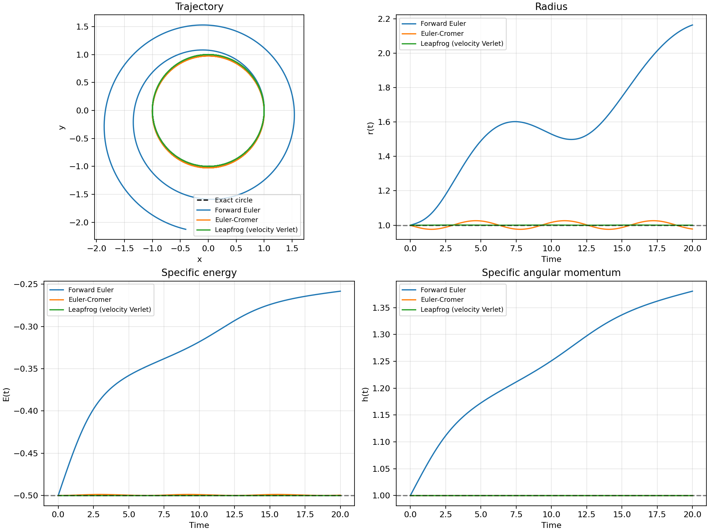
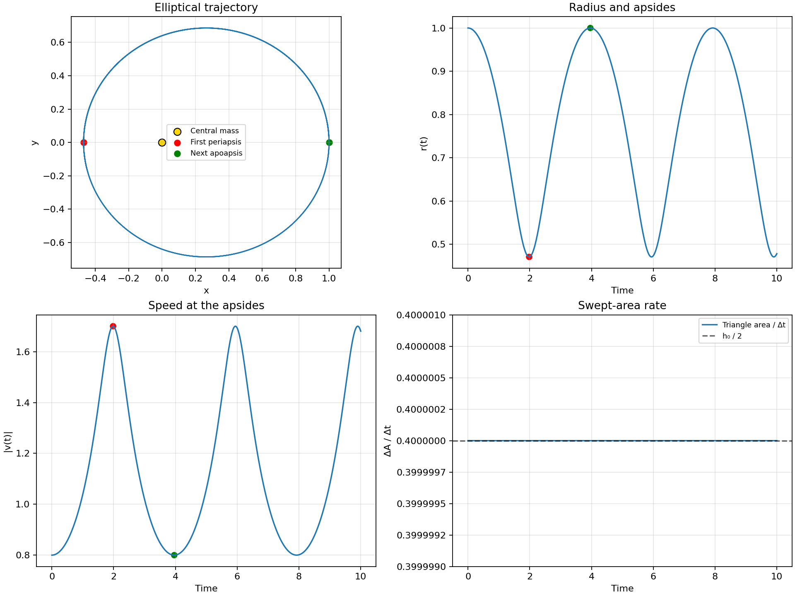

# Integrator, period, and elliptical-orbit checks

## Predictions before running

For the method comparison, use \(GM=1\), \((x_0,y_0)=(1,0)\), \((v_{x,0},v_{y,0})=(0,1)\), \(\Delta t=0.05\), and total time 20 for all three methods. The exact circular orbit has \(r=1\), specific energy \(E=-0.5\), specific angular momentum \(h=xv_y-yv_x=1\), and period \(T=2\pi\approx6.283185\).

I expect forward Euler to accumulate energy and angular momentum error and spiral outward. Euler-Cromer should keep errors bounded but show visible radius and energy oscillations. Kick-drift-kick leapfrog (velocity Verlet) should have smaller radius and energy errors at the same timestep. A trajectory that looks circular or elliptical by eye is insufficient evidence; compare \(r(t)\), \(E(t)\), and \(h(t)\).

The code applies the three updates as follows, with \(\mathbf a_n=-GM\mathbf r_n/|\mathbf r_n|^3\):

| Method | Position and velocity update |
| --- | --- |
| Forward Euler | \(\mathbf r_{n+1}=\mathbf r_n+\mathbf v_n\Delta t\); \(\mathbf v_{n+1}=\mathbf v_n+\mathbf a_n\Delta t\) |
| Euler-Cromer | \(\mathbf v_{n+1}=\mathbf v_n+\mathbf a_n\Delta t\); \(\mathbf r_{n+1}=\mathbf r_n+\mathbf v_{n+1}\Delta t\) |
| Leapfrog / velocity Verlet | \(\mathbf r_{n+1}=\mathbf r_n+\mathbf v_n\Delta t+\tfrac12\mathbf a_n\Delta t^2\); \(\mathbf v_{n+1}=\mathbf v_n+\tfrac12(\mathbf a_n+\mathbf a_{n+1})\Delta t\) |

All angular-momentum values in the code are *specific* angular momentum \(h=L/m\). For unit mass, the user's \(L(t)\) and the plotted \(h(t)\) have the same numerical value.

Estimate one period from the first time the unwrapped polar angle reaches \(2\pi\), with linear interpolation between surrounding samples. Then calculate \(\epsilon_T=|T_{\mathrm{num}}-2\pi|/(2\pi)\).

For the elliptical test, set \((v_{x,0},v_{y,0})=(0,0.8)\) and use leapfrog with \(\Delta t=0.001\). The initial radius 1 is apoapsis. From \(E=-0.68\) and \(h=0.8\), the predicted periapsis radius is \(r_p=0.470588\); speed there should be about 1.7, greater than the apoapsis speed 0.8. The swept-area rate should be \(h/2=0.4\). For this central-force leapfrog update, each kick is radial and each drift is straight, so the triangular area from two consecutive numerical positions should equal \(h\Delta t/2\) up to rounding error.

## Results

### Three methods, identical setup

All three methods used 400 updates at \(\Delta t=0.05\) through \(t=20\). The dashed lines mark the exact circular radius 1, energy \(-0.5\), and angular momentum 1.

| Method | Max \(|r-1|\) | Max \(|E-E_0|\) | Max \(|h-h_0|\) | First revolution \(T_{\rm num}\) | Relative period error |
| --- | ---: | ---: | ---: | ---: | ---: |
| Forward Euler | 1.16336 | 0.241702 | 0.380726 | 9.750595 | 55.19% |
| Euler-Cromer | 0.0262571 | 0.00125077 | \(1.11\times10^{-15}\) | 6.294301 | 0.1769% |
| Leapfrog / velocity Verlet | 0.00124920 | \(7.78\times10^{-7}\) | \(1.11\times10^{-15}\) | 6.288414 | 0.08322% |

Forward Euler's path expands rather than closing, so its 9.750595 value is the time to turn through one full angle, not the period of a stable orbit. The growing \(E(t)\), \(h(t)\), and \(r(t)\) expose the failure more clearly than a short trajectory alone. Euler-Cromer keeps angular momentum to roundoff and shows bounded radius and energy oscillations. Leapfrog also keeps angular momentum to roundoff and has smaller radius and energy errors at this timestep.

The analytic period is \(T=2\pi=6.283185\). Leapfrog's first revolution is 6.288414, with \(\epsilon_T=8.32\times10^{-4}\). This is a direct comparison with an analytic solution, independent of how convincing the plot looks.

### Ellipse, apsides, and Kepler's second law

For \(v_0=0.8\), the radius repeatedly falls from 1 to about 0.470589 and rises back to 1. The first sampled periapsis occurs at \(t=1.981\), and the next sampled apoapsis at \(t=3.962\).

| Point | Time | Radius | Speed |
| --- | ---: | ---: | ---: |
| First periapsis | 1.981 | 0.470589158 | 1.699996695 |
| Next apoapsis | 3.962 | 0.999999972 | 0.800000035 |

The object is about 2.125 times faster at periapsis. The measured speeds agree with the angular-momentum prediction \(rv=h=0.8\) at each apsis.

The triangular swept-area rate \(\Delta A/\Delta t\) stays at 0.4. Its maximum absolute difference from \(h_0/2=0.4\) is \(5.33\times10^{-13}\). This near-exact result is partly a property of the leapfrog update: radial kicks preserve angular momentum, while the straight drift gives triangle area \(h\Delta t/2\). It validates the numerical scheme's area law to floating-point precision; it does not by itself establish that every other orbital property is equally accurate.

## Reproduce

From the project folder, run `.venv/bin/python src/method_comparison.py` and `.venv/bin/python src/elliptical_validation.py` after following the environment setup in `README.md`. The scripts regenerate the two figures, `data/method_comparison.csv`, `data/elliptical_orbit.csv`, and `data/swept_area.csv`.
