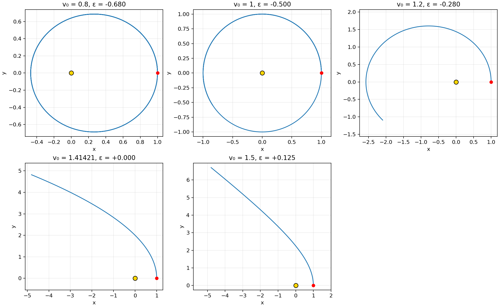
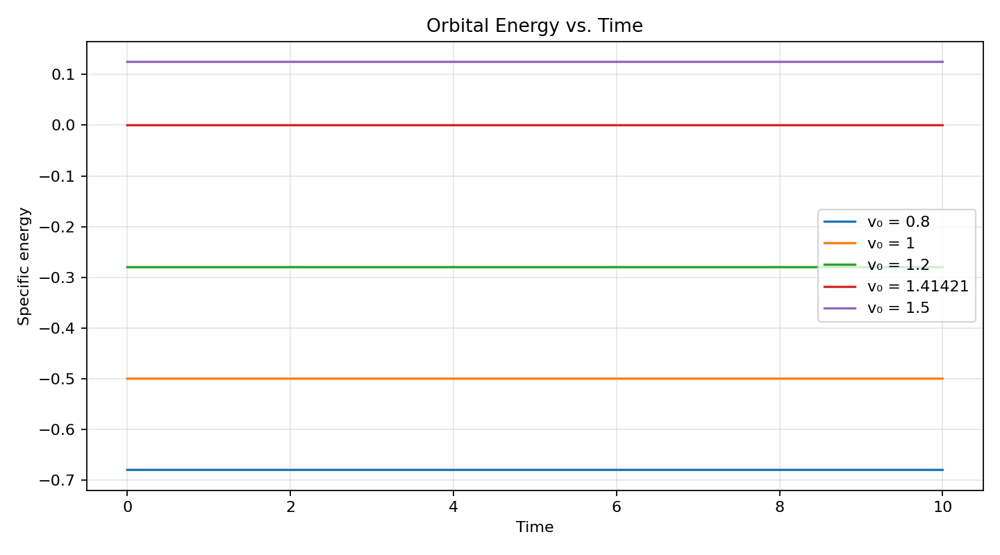

# Orbit experiments: changing the initial speed

## Setup and predictions (written before the runs)

The simulation starts at \((x,y)=(1,0)\) with tangential velocity \((v_x,v_y)=(0,v_0)\). It uses \(GM=1\), time step 0.001, and total time 10. At the starting radius \(r_0=1\), the circular speed is \(v_c=\sqrt{GM/r_0}=1\), the escape speed is \(v_{esc}=\sqrt{2GM/r_0}=\sqrt2\), and the specific orbital energy is

\[
\varepsilon=\frac{v_0^2}{2}-\frac{GM}{r_0}=\frac{v_0^2}{2}-1.
\]

Negative energy means a bound orbit; zero is the parabolic escape threshold; positive energy means an unbound hyperbola. Because the initial velocity is perpendicular to the radius, the starting point is a radial turning point. A speed below circular makes it apoapsis; a speed above circular makes it periapsis.

| Initial speed \(v_0\) | Initial energy \(\varepsilon\) | Prediction | Starting location |
| --- | ---: | --- | --- |
| 0.8 | -0.68 | Bound ellipse | Apoapsis |
| 1.0 | -0.50 | Circle | Every point equivalent |
| 1.2 | -0.28 | Bound ellipse | Periapsis |
| \(\sqrt2\) | 0 | Parabola / escape threshold | Periapsis |
| 1.5 | +0.125 | Hyperbola / unbound | Periapsis |

## Results

The yellow dot is the central mass and the red dot is the starting point. Distances below are from the central mass. Each trajectory was sampled at 0.001 time-unit intervals through \(t=10\).

### Experiment 1

**Initial velocity:** \(v_0=0.8\), directed along +\(y\).

**My prediction:** A bound elliptical orbit. The starting radius should be apoapsis, and the object should initially move inward.

**Reason:** \(v_0<v_c=1\) and \(\varepsilon=0.5(0.8)^2-1=-0.68<0\), so the orbit is bound. At the starting point, the radial acceleration is \(\ddot r=v_0^2-1=-0.36<0\), so the body moves inward from a radial maximum. From energy and angular momentum, the predicted periapsis radius is about 0.470588.

**Actual simulation:** The path is an ellipse. It starts at the largest radius, 1.000000, and reaches a minimum radius of 0.470589 during the run. At \(t=10\), its radius is 0.477965.

**Was my reasoning correct?** Yes. The starting point is apoapsis, and the measured periapsis is within 0.000002 of the predicted value.

### Experiment 2

**Initial velocity:** \(v_0=1.0\), directed along +\(y\).

**My prediction:** A circular orbit of radius 1.

**Reason:** \(v_0=v_c=1\). Gravity supplies exactly the centripetal acceleration required for circular motion: \(GM/r_0^2=v_0^2/r_0=1\). The energy is \(\varepsilon=-0.50<0\), so the orbit is bound.

**Actual simulation:** The path is circular. Its radius ranges from 1.000000000 to 1.000000500 during the run.

**Was my reasoning correct?** Yes. The tiny radius variation is numerical error from the finite time step.

### Experiment 3

**Initial velocity:** \(v_0=1.2\), directed along +\(y\).

**My prediction:** A bound elliptical orbit. The starting radius should be periapsis, and the object should initially move outward.

**Reason:** \(1<v_0<\sqrt2\), and \(\varepsilon=0.5(1.2)^2-1=-0.28<0\). Thus the orbit is bound, while \(\ddot r=v_0^2-1=+0.44>0\) makes the starting point a radial minimum. Energy and angular momentum predict an apoapsis radius of about 2.571429.

**Actual simulation:** The path is an ellipse. Its smallest radius is 1.000000 at the start. It reaches a maximum radius of 2.571430 at about \(t=7.497\), then begins moving inward. The run ends before it completes the ellipse.

**Was my reasoning correct?** Yes. The starting point is periapsis, and the measured apoapsis matches the prediction.

### Experiment 4

**Initial velocity:** \(v_0=\sqrt2\approx1.414214\), directed along +\(y\).

**My prediction:** A parabolic orbit at the escape threshold, with the starting point at periapsis.

**Reason:** \(v_0=v_{esc}=\sqrt2\), so \(\varepsilon=0\). The radial acceleration at the start is \(\ddot r=v_0^2-1=+1\), so the body moves outward from its closest approach. In the ideal two-body model, zero energy separates bound and unbound orbits.

**Actual simulation:** The trajectory curves away from the central mass without turning back during the run. Its radius rises from 1.000000 to 6.804722 at \(t=10\).

**Was my reasoning correct?** Yes within the simulated interval. The outward trajectory and zero initial energy agree with a parabolic escape orbit; a finite run cannot observe the entire infinite path.

### Experiment 5

**Initial velocity:** \(v_0=1.5\), directed along +\(y\).

**My prediction:** An unbound hyperbolic orbit, with the starting point at periapsis.

**Reason:** \(v_0>v_{esc}=\sqrt2\), and \(\varepsilon=0.5(1.5)^2-1=+0.125>0\). The body has more than the energy needed to escape. Its initial radial acceleration is \(\ddot r=v_0^2-1=+1.25\), so it moves outward from its closest approach.

**Actual simulation:** The trajectory moves outward throughout the run. Its radius rises from 1.000000 to 8.244197 at \(t=10\), farther than the \(\sqrt2\) case.

**Was my reasoning correct?** Yes within the simulated interval. Positive energy identifies a hyperbolic orbit in the ideal two-body model, and the computed path moves away as predicted.

## Energy versus time

For each saved state, the simulation now calculates specific kinetic energy \(K=(v_x^2+v_y^2)/2\), specific potential energy \(U=-GM/r\), and total specific energy \(E=K+U\). Each \(E_n\) is stored with its corresponding time \(t_n\), including the initial state at \(t=0\).

**Prediction:** In this fixed-mass, gravity-only model, total specific energy should be constant. Each \(E(t)\) curve should therefore be horizontal. Small changes arise from numerical integration and floating-point rounding. A steadily rising or falling curve would suggest that the time step or method needs attention.

The graph appears flat at this scale. The maximum absolute change \(\max_t |E(t)-E(0)|\) quantifies the small differences:

| Initial speed \(v_0\) | Initial \(E\) | Maximum absolute energy change |
| --- | ---: | ---: |
| 0.8 | -0.680000 | \(1.450\times10^{-6}\) |
| 1.0 | -0.500000 | \(1.225\times10^{-13}\) |
| 1.2 | -0.280000 | \(7.900\times10^{-8}\) |
| \(\sqrt2\) | 0.000000 | \(1.347\times10^{-7}\) |
| 1.5 | +0.125000 | \(1.597\times10^{-7}\) |

The circular case is especially accurate because its radius and speed remain almost constant. The 0.8 ellipse approaches closest to the central mass and has the largest energy variation, though its drift is still small compared with its initial energy. These results support the predicted orbit classifications without treating a finite simulation as an exact solution.

## Reproduce

After setting up the Python environment described in `README.md`, run `.venv/bin/python src/orbit_simulation.py` from the project folder to regenerate the default orbit, `plots/orbit_energy.png`, and `data/orbit_energy.csv`. Run `.venv/bin/python src/orbit_experiments.py` to regenerate the five trajectory plots, `plots/orbit_experiments_energy.png`, and `data/orbit_experiments_energy.csv`; it also prints the measured radius ranges and maximum energy changes. Each CSV row pairs a time with its energy sample or samples.
