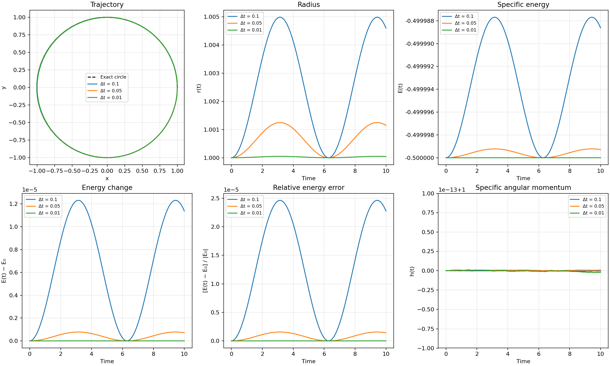

# Timestep and conservation experiment

## Prediction before running

Use the same circular-orbit initial state for every run: \(GM=1\), \((x_0,y_0)=(1,0)\), \((v_{x,0},v_{y,0})=(0,1)\), and total time \(T=10\). Compare \(\Delta t=0.1\), 0.05, and 0.01 with the velocity Verlet integrator in `src/orbit_simulation.py`.

The exact orbit has radius \(r(t)=1\), specific energy \(E(t)=-0.5\), and specific angular momentum \(h(t)=xv_y-yv_x=1\). I expect the trajectory, radius, and energy to get closer to these values as the timestep shrinks. The number of updates should be \(T/\Delta t\): 100, 200, and 1000 respectively, so the smaller timestep costs more computation.

The energy diagnostics are

\[
\Delta E(t)=E(t)-E_0,\qquad
\text{relative energy error}(t)=\frac{E(t)-E_0}{|E_0|}.
\]

Here \(E_0=-0.5\), so the relative error is defined. A relative error of \(10^{-2}\) is 1%, while \(10^{-4}\) is 0.01%. For a zero-energy orbit, this relative measure is undefined; use absolute \(\Delta E\) instead.

## Measured results

The figure compares trajectory shape, radius, energy, energy change, relative energy error, and angular momentum for the three timesteps. The black dashed curve in the trajectory panel is the exact unit circle. The horizontal scales cover the same \(T=10\) time units.

All errors in the table are the largest absolute difference at any saved time. The trajectory error is the distance from the exact position \((\cos t,\sin t)\); it includes phase error that can be hard to see in the overlaid paths.

| \(\Delta t\) | Updates \(N\) | Max trajectory error | Max \(|r-1|\) | Max \(|\Delta E|\) | Max relative energy error | Max \(|h-1|\) |
| ---: | ---: | ---: | ---: | ---: | ---: | ---: |
| 0.1 | 100 | \(3.6205\times10^{-2}\) | \(4.9864\times10^{-3}\) | \(1.2312\times10^{-5}\) | \(2.4624\times10^{-5}\) | \(5.55\times10^{-16}\) |
| 0.05 | 200 | \(9.0776\times10^{-3}\) | \(1.2492\times10^{-3}\) | \(7.7832\times10^{-7}\) | \(1.5566\times10^{-6}\) | \(8.88\times10^{-16}\) |
| 0.01 | 1000 | \(3.6344\times10^{-4}\) | \(4.9999\times10^{-5}\) | \(1.2498\times10^{-9}\) | \(2.4996\times10^{-9}\) | \(2.44\times10^{-15}\) |

### What the results mean

- **Trajectory and radius:** The plotted paths nearly overlap, but the measured errors clearly fall as \(\Delta t\) decreases. Halving the timestep from 0.1 to 0.05 reduces the maximum trajectory error by about fourfold, consistent with the second-order accuracy of velocity Verlet in this experiment.
- **Energy:** \(E(t)\) stays close to \(-0.5\). Its small error oscillates instead of growing steadily over these 10 time units. The relative energy error drops from about \(2.46\times10^{-5}\) (0.00246%) at \(\Delta t=0.1\) to \(2.50\times10^{-9}\) (0.00000025%) at \(\Delta t=0.01\).
- **Angular momentum:** \(h(t)\) remains 1 to roughly machine precision in every run. The measured differences are roundoff noise, so they do not decrease consistently with timestep. For a central force, each velocity Verlet kick points along the radius and each drift follows the velocity; both preserve \(xv_y-yv_x\) apart from floating-point rounding.
- **Cost:** The 0.01 run uses 1000 updates, ten times as many as the 0.1 run. It is more accurate but requires more integration work. Update count is a simple cost proxy; actual runtime also depends on the machine and plotting overhead.

These diagnostics are stronger than visual inspection alone: a trajectory can look circular while its phase, radius, or energy is measurably wrong.

## Reproduce

After setting up the Python environment described in `README.md`, run `.venv/bin/python src/timestep_experiment.py` from the project folder. It regenerates `plots/timestep_conservation.png` and `data/timestep_conservation.csv`. The CSV records timestep, time, radius, \(E(t)\), \(\Delta E(t)\), relative energy error, and \(h(t)\) for every saved sample. The main `src/orbit_simulation.py` script also saves `plots/orbit_angular_momentum.png` and `data/orbit_diagnostics.csv` for its default run.
