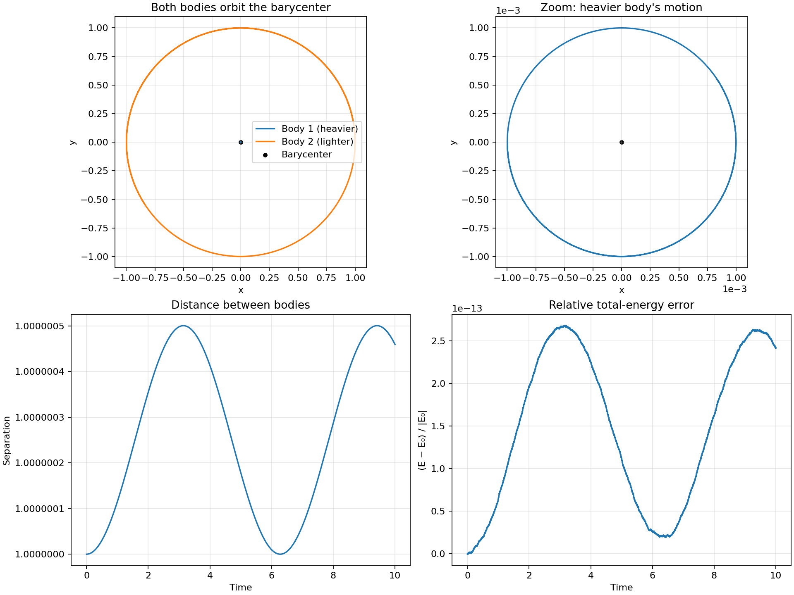

# Two moving bodies under gravity

## Setup and prediction

The bodies have masses \(m_1=1\) and \(m_2=0.001\), with \(G=1\), initial separation 1, timestep 0.001, and duration 10. Their initial positions and velocities are chosen so the center of mass starts at rest at the origin. The heavier body should trace a small circle and the lighter body a much larger circle around that common center.

At every step, the code calculates \(\mathbf d=\mathbf r_2-\mathbf r_1\) and \(r=|\mathbf d|\). It applies the coupled accelerations

\[
\mathbf a_1=\frac{Gm_2\mathbf d}{r^3},\qquad
\mathbf a_2=-\frac{Gm_1\mathbf d}{r^3}.
\]

Leapfrog uses these accelerations to update both velocities by half a timestep, both positions by a full timestep, then both velocities by another half timestep using the new separation. The same gravitational interaction acts on both bodies.

For the circular initial state, the relative separation should remain near 1. Total energy, angular momentum, linear momentum, and the center of mass should stay nearly constant. The heavier body's orbital radius should be \(m_2/(m_1+m_2)\approx0.000999\), while the lighter body's should be \(m_1/(m_1+m_2)\approx0.999001\).

## Results

The run saved 10,001 samples from \(t=0\) to \(t=10\). Both bodies move around the barycenter. The heavier body's circle is small enough to need a separate zoomed panel; it is not fixed at the origin.

| Diagnostic | Largest measured change or magnitude |
| --- | ---: |
| Change in separation from 1 | \(5.005\times10^{-7}\) |
| Relative total-energy error | \(2.678\times10^{-13}\) |
| Change in total angular momentum | \(1.214\times10^{-17}\) |
| Center-of-mass drift | \(5.524\times10^{-18}\) |
| Total linear momentum magnitude | \(5.896\times10^{-18}\) |

The nearly constant separation supports the circular-orbit prediction. Its small variation and the energy error come from the finite timestep. Angular momentum, total linear momentum, and the center of mass stay close to their initial values at roughly floating-point precision. The CSV file stores both positions, both velocities, separation, and these diagnostics at every saved time.

## Reproduce

From this experiment's folder, run `.venv/bin/python src/two_body_orbit.py` after following the dependency setup in `README.md`. It regenerates `plots/two_body_orbit.png` and `data/two_body_orbit.csv`.
